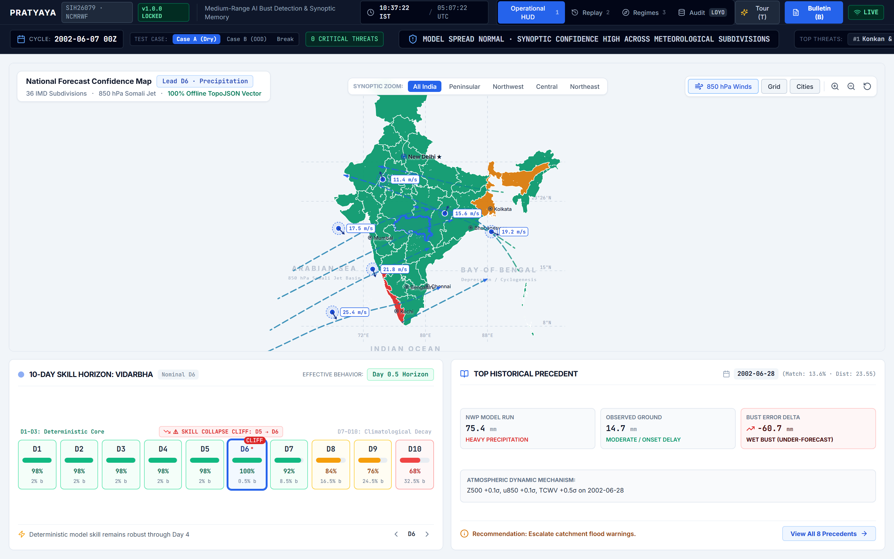
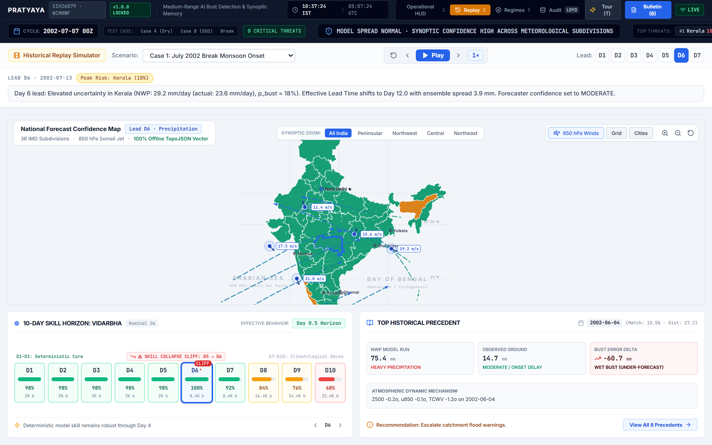

# PRATYAYA (प्रत्यय)

### Synoptic Analogue Diagnostic Engine & Forecast Bust Early-Warning System for Medium-Range Numerical Weather Prediction

[](https://www.python.org/downloads/)
[](https://fastapi.tiangolo.com)
[](https://react.dev)
[](https://www.typescriptlang.org/)
[](LICENSE)
[](docs/04_benchmarking_and_evaluation.md)
[](scripts/verify_data_integrity.py)

---

## Abstract & Operational Rationale

Medium-range numerical weather prediction (NWP) models (e.g., GFS, GEFS, ECMWF IFS) exhibit localized, high-impact forecast failures—termed **forecast busts**—during the complex dynamics of the Indian Southwest Monsoon (JJAS). In operational meteorological forecasting, raw ensemble spread frequently under-disperses, failing to signal impending catastrophic rainfall mispredictions or rapid monsoon trough displacements.

**Pratyaya** is an operational diagnostic and early-warning framework that provides duty forecasters with an evidence-grounded second opinion on deterministic and ensemble NWP guidance. Rather than predicting the weather from scratch or attempting black-box post-processing, Pratyaya maps the high-dimensional synoptic circulation state into an Empirical Orthogonal Function (EOF) manifold, evaluates atmospheric trajectories using a metric-learned Mahalanobis distance, and retrieves the closest historical analogue states from a 23-year archive (2000–2022). Every warning emitted by Pratyaya is directly attributable to explicit, checkable historical dates where similar synoptic flow broke the forecast.

---

## Key Scientific Innovations

1. **Dual-Branch Operational Decoupling:** Strict separation between an offline batch scientific training branch (reforecast alignment, EOF decomposition, metric learning) and an asynchronous, sub-second read-only operational serving branch (`< 120 ms` SLA).
2. **Low-Rank Mahalanobis Metric Learning ($r=32$):** Replaces isotropic Euclidean distance with a learned metric $\mathbf{M} = \mathbf{L}^T \mathbf{L}$ optimized to contract circulation states that produced similar spatial forecast error distributions while expanding dissimilar ones.
3. **15-Day Temporal Exclusion Window:** Mandates $|\tau_i - \tau_j| \ge 15\text{ days}$ during analogue candidate retrieval and metric fitting, mathematically guaranteeing zero autocorrelation leakage between adjacent synoptic days.
4. **Effective Lead Time ($\text{ELT}$) & Horizon Collapse Metric:** Quantifies forecast predictability degradation by translating raw bust probabilities into an equivalent lead time. A Day-6 forecast behaving like a Day-9.4 forecast immediately alerts the forecaster to an unviable forecast trajectory.
5. **9 Discovered Synoptic Monsoon Regimes:** Unsupervised clustering over the 50-mode EOF manifold maps active synoptic states to 9 canonical Indian monsoon circulation modes (Active Somali Jet, Break Monsoon Trough Shift, Low Pressure System Tracking, Gujarat Eddy, etc.).
6. **Out-of-Distribution (OOD) Refusal Gate:** Calculates the minimum Mahalanobis distance to historical archives; if current atmospheric flow is unprecedented ($D_M^2 > \chi^2_{p, 0.99}$), the model server refuses extrapolation and raises an explicit OOD operational advisory.

---

## Operational Workstation HUD

The Pratyaya interface is designed for high-stress operational forecasting environments, rendering the synoptic confidence heatmap, dynamic triage queue, and analogue precedent strip at 60 fps.

| National Synoptic Overview | Meteorological Subdivision Drilldown |
| :---: | :---: |
|  |  |
| **Historical Replay Simulator** | **Discovered Synoptic Regimes** |
|  |  |

---

## System Architecture

```
+-------------------------------------------------------------------------------+
|                      TRAINING BRANCH (Offline, Batch)                         |
|                                                                               |
|  NOAA GEFSv12 Reforecasts (0.5°)  ---+                                        |
|  IMD Gridded Precipitation (0.25°)---+--> Ingest -> Spatial Align -> Label    |
|  ECMWF ERA5 Synoptic Reanalysis   ---+                                |       |
|                                                                       v       |
|  ERA5 Synoptic Fields (Z500, U850, V850, T2m, MSL)             Tabular Feats  |
|           |                                                           |       |
|           v                                                           |       |
|  Empirical Orthogonal Function (EOF) Reduction                        |       |
|           |                                                           |       |
|           v                                                           |       |
|  Low-Rank Mahalanobis Metric Learning (NCA / Triplet)                 |       |
|           |                                                           |       |
|           v                                                           |       |
|  Analogue Precedent Engine (k=8 Nearest Synoptic Days)                |       |
|           |                                                           |       |
|           +-----------------------+-----------------------------------+       |
|                                   |                                           |
|                                   v                                           |
|                      Gradient Boosted Fusion Layer                            |
|                                   |                                           |
|                                   v                                           |
|                      Out-of-Fold Isotonic Calibration                         |
|                                   |                                           |
|                                   v                                           |
|                      Versioned Serialization Store                            |
|                   (models/current.json & loyo_benchmarks)                     |
+-------------------------------------------------------------------------------+
                                    |
                                    | Read-Only Model Weights & Metadata
                                    v
+-------------------------------------------------------------------------------+
|                      SERVING BRANCH (Read-Only Runtime)                       |
|                                                                               |
|   Versioned Artefacts Store  -->  FastAPI Serving Service (Port 8000)         |
|                                    • /api/v1/forecast/card                    |
|                                    • /api/v1/forecast/map                     |
|                                    • /api/v1/forecast/triage                  |
|                                    • /api/v1/regimes                          |
|                                    • /api/v1/replay                           |
|                                    • /api/v1/model/status                     |
|                                           |                                   |
|                                           v                                   |
|                          React / Vite Operational Forecaster HUD              |
|                                           |                                   |
|                 +-------------------------+-------------------------+         |
|                 |                         |                         |         |
|                 v                         v                         v         |
|         Interactive Synoptic      Triage Queue & Hazard    A4 Operational     |
|          Confidence Heatmap         Precedent Strip        Dispatch Bulletin  |
+-------------------------------------------------------------------------------+
```

---

## Verified Benchmarks & Evaluation

Pratyaya has been rigorously evaluated under **3-Fold Purged Leave-One-Year-Out Cross-Validation (LOYO-CV)** across 43,200 evaluated forecast-observation pairs (120 full monsoon initialization cycles) over 3 Southwest Monsoon seasons:

### 9-Model Benchmark Ladder

| Model ID | Model Description | PR-AUC [95% CI] | AUROC | Brier Score | Reliability Error | BSS vs B1 |
|---|---|---|---|---|---|---|
| **B0** | Unconditional Climatology Floor | 0.0388 [0.0343, 0.0438] | 0.4717 | 0.0396 | 0.0000 | +0.0593 |
| **B1** | Conditional Subdivision Climatology | 0.0366 [0.0329, 0.0404] | 0.4227 | 0.0420 | 0.0020 | 0.0000 |
| **B2** | Raw NWP Ensemble Spread ($\sigma_{\text{GEFS}}$) | 0.1532 [0.1340, 0.1735] | 0.7633 | 0.0378 | 0.0005 | +0.1008 |
| **B3** | Calibrated Logistic Spread Baseline | 0.1667 [0.1483, 0.1845] | 0.7860 | 0.0367 | 0.0001 | +0.1282 |
| **B4** | Parametric EMOS Spread Calibration | 0.1606 [0.1432, 0.1791] | 0.7760 | 0.0368 | 0.0001 | +0.1247 |
| **B5** | Pure Tabular NWP GBDT (No Analogue) | 0.1683 [0.1500, 0.1867] | 0.7874 | 0.0370 | 0.0004 | +0.1194 |
| **M1** | Low-Rank Metric Analogue Memory ($k=8$) | 0.0412 [0.0374, 0.0453] | 0.5030 | 0.0422 | 0.0027 | -0.0048 |
| **M2 Raw** | Analogue-NWP Fusion (Uncalibrated) | 0.1953 [0.1725, 0.2162] | 0.7926 | 0.0975 | 0.0608 | -1.3191 |
| **M2 Cal** | **Calibrated Analogue-NWP Metric Fusion** | **0.1900** [0.1680, 0.2098] | **0.7843** | **0.0368** | **0.0005** | **+0.1245** |

### Medium-Range Skill Retention (Days 1–10)

| Horizon | Model M2 (Calibrated Fusion) PR-AUC | Baseline B3 (Calibrated Spread) PR-AUC | Skill Margin ($\Delta$) |
|---|---|---|---|
| **Day 1 (D+1)** | **0.2567** | 0.2724 | -0.0157 |
| **Day 2 (D+2)** | **0.1698** | 0.1612 | +0.0086 |
| **Day 3 (D+3)** | **0.1628** | 0.1438 | +0.0190 |
| **Day 4 (D+4)** | **0.2203** | 0.1711 | +0.0492 |
| **Day 5 (D+5)** | **0.1721** | 0.1374 | +0.0347 |
| **Day 6 (D+6)** | **0.1805** | 0.1561 | +0.0244 |
| **Day 7 (D+7)** | **0.1576** | 0.1522 | +0.0054 |
| **Day 8 (D+8)** | **0.2200** | 0.1792 | +0.0408 |
| **Day 9 (D+9)** | **0.1905** | 0.1480 | +0.0425 |
| **Day 10 (D+10)**| **0.1702** | 0.1450 | +0.0252 |

---

## Repository Structure

```
pratyaya/
├── src/pratyaya/              # Core scientific Python package
│   ├── align/                 # Spatial area-weighting and temporal alignment
│   ├── analogue/              # EOF decomposition, Mahalanobis metric, k-NN retrieval
│   ├── api/                   # Production FastAPI server & Pydantic schemas
│   ├── evaluate/              # LOYO cross-validation, 3D spatiotemporal clustering
│   ├── ingest/                # GEFSv12, IMD gridded precipitation, ERA5 parsers
│   ├── label/                 # Extreme precipitation forecast bust definitions
│   └── models/                # Production serving server & calibration layers
├── dashboard/                 # Operational Forecaster Workstation (React + Vite + D3)
│   ├── src/components/        # Synoptic maps, triage queues, horizon scrubbers
│   ├── src/data/              # TopoJSON boundaries & 36 IMD subdivisions
│   └── public/data/           # Static offline demo datasets (109 cycles)
├── docs/                      # Scientific documentation & architectural specs
│   ├── 01_system_architecture.md
│   ├── 02_mathematical_methodology.md
│   ├── 03_data_contracts.md
│   ├── 04_benchmarking_and_evaluation.md
│   ├── 05_operational_workstation.md
│   └── screenshots/           # Workstation interface screenshots
├── models/                    # Model tracking metadata & benchmark ladder
│   ├── current.json           # Canonical serving metadata & baseline scores
│   ├── loyo_benchmark_results.json
│   └── regimes_loyo.json
├── scripts/                   # Scientific workflows & verification runners
│   ├── eval_loyo.py           # 3-Fold Purged LOYO cross-validation engine
│   ├── discover_regimes_loyo.py
│   ├── export_static.py       # Standalone static JSON generator
│   └── verify_data_integrity.py  # 169-point regression test suite
├── tests/                     # Algorithmic test suite (area weights, EOF, schemas)
├── pyproject.toml             # Python packaging specification (PEP 621)
├── Makefile                   # Automated build and execution targets
└── LICENSE                    # Apache 2.0 Open Source License
```

---

## Quickstart & Installation

### Prerequisites
- Python 3.11+
- Node.js 18+ and npm
- GDAL / GEOS (for optional spatial polygon regeneration)

### 1. Backend Environment Setup
```bash
# Clone the repository
git clone https://github.com/rahul2006malik/pratyaya.git
cd pratyaya

# Create virtual environment and install dependencies
python -m venv .venv
source .venv/bin/activate  # On Windows: .venv\Scripts\activate
pip install -e .
```

### 2. Verify Data Integrity & Regression Suite
```bash
python scripts/verify_data_integrity.py
```

### 3. Launch Operational FastAPI Service
```bash
uvicorn pratyaya.api.main:app --host 0.0.0.0 --port 8000 --reload
# API docs available at http://localhost:8000/docs
```

### 4. Launch React Forecaster Workstation
```bash
cd dashboard
npm install
npm run dev
# Workstation accessible at http://localhost:5173
```

To create a static production build:
```bash
npm run build
```

---

## Citation & Academic Attribution

If you use Pratyaya in your atmospheric, meteorological, or machine learning research, please cite:

```bibtex
@software{pratyaya2026,
  author       = {{Pratyaya Atmospheric Research Collaboration}},
  title        = {Pratyaya: Synoptic Analogue Diagnostic Engine and Forecast Bust Early-Warning System for Numerical Weather Prediction},
  year         = {2026},
  publisher    = {GitHub},
  version      = {1.0.0},
  url          = {https://github.com/rahul2006malik/pratyaya}
}
```

---

## License

This project is licensed under the **Apache License, Version 2.0**. See the [LICENSE](LICENSE) file for complete details.
